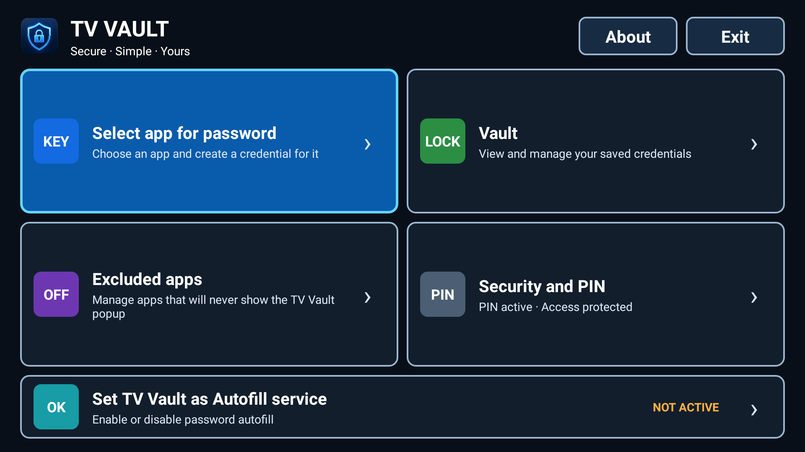
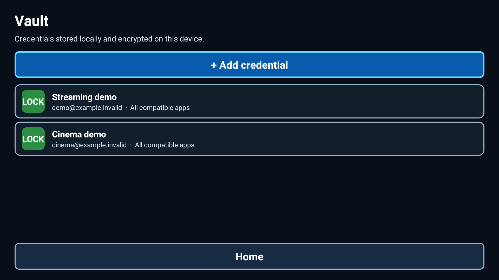
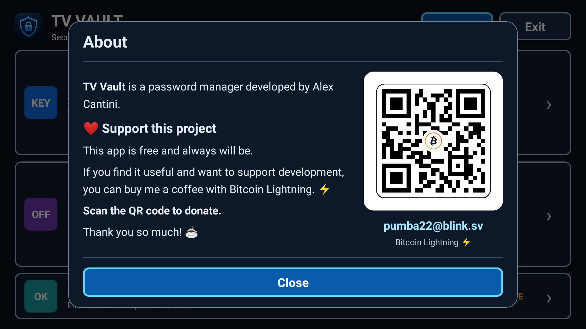

# TV Vault 0.17.6

Offline password manager for Android TV, created by Alex Cantini.
Android 9 (API 28) or later. English UI by default, Italian on Italian systems.
Single-screen Home with Exit at top right; initial security disclosure with
Accept/Decline and optional Do not show again. Decline exits without deleting data.
TV remote/D-pad navigation. Only apps that expose compatible Android Autofill
fields can be filled. No Google Password Manager access or cloud account.

## Features
- Create, edit and delete local username/password credentials.
- Associate a credential with an app or make it available to compatible apps.
- Choose the Android Autofill service from the home screen.
- Exclude apps from Autofill suggestions.
- Optional numeric PIN: 4–12 digits, disabled by default.
- Separate Require PIN for autofill checkbox, protected by the settings visit authorization.
  It defaults to checked; unchecking leaves app-entry protection enabled.
- Settings to enable/change/disable the PIN and read security information.

## Security and data loss
The complete local JSON credential list is encrypted using AES-256-GCM.
The existing Android Keystore alias TVVaultLocalKeyV1 and private
SharedPreferences tvvault_secure/vault remain unchanged from 0.16.3.
The app has no INTERNET permission, analytics or cloud synchronization.
The optional PIN is an access gate, not a key-derivation password for the vault.
Its salted verifier is HMAC-SHA256 with a non-exportable Android Keystore key;
the PIN is not intentionally persisted in cleartext. PINs saved by 0.17.0 are
verified once with legacy PBKDF2 (210,000 iterations), then atomically upgraded
after a successful unlock. That first unlock may still take several seconds. Delays start after five failures,
persist across app restarts and rise from 30 seconds to a maximum of 300 seconds.
When enabled, the gate applies to both entry points and reappears on pause,
background return, a new launcher intent and screen-off/on (TV standby).
Home clearly reports whether a PIN is enabled or has not been configured. A stopped PIN verification cannot unlock a new gate.
Screenshots, recent-app previews and ordinary screen capture are blocked by
FLAG_SECURE on vault activities. Device compromise/root is outside this protection.

Without a PIN, anyone able to use the app can access saved credentials.
The PIN cannot be recovered. Clearing app data or uninstalling deletes the vault
and PIN; there is no export, cloud backup or recovery feature. Losing the
Keystore key may permanently lose access. Read/decrypt errors block writes.
There has been no independent security audit. See SECURITY.md.

## Updating existing installations
Keep the package com.alexcantini.tvvault and sign updates with the same
certificate as the installed app. A new release key will not update an app
signed with a different key. Do not uninstall or clear data to bypass a signature
error: that loses the vault. First check the installed certificate and plan the
transition. Existing data-format compatibility is covered by regression tests;
actual Android Keystore and update behavior still require a device test.

## Building
Use a free Java 17+ JDK, Android SDK platform 35, and build-tools 34.0.0.
AGP 8.7.3 / Gradle 8.9. No third-party runtime dependencies.
Set ANDROID_HOME or create an untracked local.properties with sdk.dir.

```sh
./gradlew assembleRelease assembleDebug lintRelease --console=plain
```

Windows: use gradlew.bat. Release R8 is enabled. Dependency metadata is disabled.
The release output is app/build/outputs/apk/release/app-release-unsigned.apk.
Build from a clean, committed checkout. Tag exactly the commit used to build the
release. Do not edit source or move an already-published tag after release.
The build pins the Gradle distribution SHA-256.

## Signing and F-Droid
A definitive signing key is not embedded. The release signing helper is delivered
separately and requests secrets locally. Use a recent apksigner supporting
--alignment-preserved true. Keep private keys and passwords out of source control
and back up the key and password separately.
Source repository: https://github.com/22pumba22/TVVault

F-Droid preparation is in docs/FDROID.md. Fastlane metadata and localized synthetic interface exports are under
fastlane/metadata/android/en-US and it-IT. The images are rendered from the
Android interface while retaining screen capture protection.
Compilation and local tests do not imply F-Droid acceptance.

## License and attribution
GPL-3.0-only; see LICENSE, NOTICE and SOURCES.md. The supplied original project
records a derivation from GPL Bitwarden Autofill code. Its exact referenced tag
and license were verified. Original artwork is retained and fitted to 16:9 TV banners;
the publisher has confirmed public redistribution rights for the supplied artwork.

Secret entry reveals the latest typed character for 1000 ms then masks it automatically.
A layout span refresh invalidates cached hardware glyphs; stored and pasted values stay masked.

## Navigation and settings (0.17.4)
Home returns to the initial page without granting access. A locked Home contains
no decrypted credentials; protected actions require unlock. Security and PIN has
its own entry gate, once per visit. Leaving or backgrounding invalidates access.
Secret input reveals the last typed character for 1000 ms, then masks it automatically.

## Navigation and Autofill settings (0.17.5)
The initial application PIN gate has Exit instead of Home. Internal navigation
buttons use Home in both languages, including the vault, editor, app picker and
exclusions. Invalid PIN format and an incorrect PIN have separate messages.
An authenticated round trip to the explicitly resolved system Autofill settings
does not ask for the PIN again. This exception expires after two minutes and is
revoked by screen-off, a new launcher intent or process death. Other background
transitions retain normal locking. Secret UI is cleared while settings are open.

## About popup (0.17.6)
About is available next to Exit on Home. It opens a centered, rounded dark popup
over the existing Home, with project information, optional Bitcoin Lightning
support, the user-supplied QR and pumba22@blink.sv. It has a visible Close button,
TV remote focus, and English/Italian resources. It is not a separate activity or
full-screen page. It makes no network requests and never opens a wallet or mail
application. Donation is voluntary and does not unlock or restrict any feature.
Screen protection and background locking apply to the dialog as to other UI.

## Interface gallery

Synthetic demonstration accounts only.






